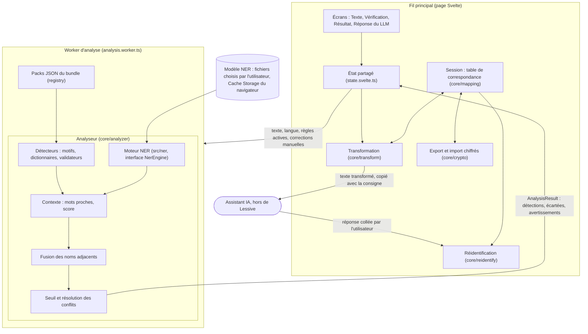

# Architecture

Ce document décrit comment Lessive est construit, pour les développeurs. Les principes du projet (R1 à R12) sont dans [CONTRIBUTING.md](CONTRIBUTING.md). En cas d'écart entre ce document et le code, le code fait foi. Le cahier des charges et le plan de construction d'origine sont archivés dans [docs/historique/](docs/historique/).

Lessive est une application web statique (Svelte 5, TypeScript, Vite). Tout le traitement a lieu dans le navigateur : aucun serveur de traitement, aucune requête hors de l'origine de l'application (R1), aucun modèle génératif (R2).

## Vue d'ensemble

L'utilisateur colle un texte ; la page l'envoie au worker avec la langue, les règles actives et les ajouts manuels. Le worker construit les détecteurs depuis les packs, y ajoute le NER s'il est chargé, puis renvoie les détections. La page applique la transformation choisie, avec la session pour les pseudonymes, et l'utilisateur copie le résultat. La réponse de l'assistant, collée plus tard, passe par la réidentification, qui lit la même session.

Le texte original, la session et les résultats restent en mémoire (R5) : rien n'est écrit dans `localStorage` ni IndexedDB. Seule exception : l'export chiffré, demandé par l'utilisateur. Le cache du navigateur ne contient que l'application et les fichiers du modèle.

## Le moteur : l'enchaînement d'une analyse

`createAnalyzer(règles actives)` (`src/core/analyzer/analyzer.ts`) enchaîne, dans cet ordre :

1. **Détecteurs.** Chaque règle de pack devient un détecteur : `PatternRecognizer` (expression régulière, avec validateur facultatif) ou `DictionaryRecognizer` (liste de termes). Un détecteur ne s'exécute que si sa langue convient à celle de l'analyse. Chaque détection porte un intervalle, un type, un score de base, la règle d'origine et une explication sans valeur du texte.
2. **NER (facultatif).** Une implémentation de `NerEngine`, passée à l'analyseur, produit des détections `PERSON`, `ORGANIZATION` et `LOCATION`. Si elle échoue, l'analyse continue avec les règles et un avertissement est ajouté ; si elle est absente, un autre avertissement le dit.
3. **Contexte** (`core/context`). Un mot de contexte dans la fenêtre de cinq mots rehausse le score de 0,35 (plafonné à 1,0) ; si la règle l'exige et qu'aucun mot n'est trouvé, la détection est écartée. Un validateur réussi porte déjà le score à 1,0 ; un validateur échoué supprime la détection.
4. **Fusion des noms adjacents** (`core/analyzer/merge-persons.ts`). Un prénom et un nom séparés seulement par des espaces, sur la même ligne, donnent une détection qui les couvre, avec un score rehaussé : un seul pseudonyme pour une personne, et un prénom ou un nom isolé sous le seuil peut être retenu.
5. **Seuil et conflits** (`core/conflicts`). Les détections sous le seuil (0,5 par défaut) sont écartées. Quand deux détections se chevauchent, la gagnante est choisie dans cet ordre : détection manuelle, validateur réussi, inclusion avec score au moins égal, score, priorité du type (`ENTITY_PRIORITY`), longueur, puis identifiants. Le résultat est trié, sans chevauchement ; les perdantes restent visibles dans `discarded`, avec la raison.

Les ajouts manuels de l'utilisateur gagnent tous les conflits. Les identifiants des détections sont `d1`, `d2`… pour le moteur et `m1`, `m2`… pour les ajouts manuels.

Ensuite, hors de l'analyseur :

- **Transformation** (`core/transform`) : applique un plan (mode, opérateur par défaut, exceptions par détection). Quatre opérateurs : `pseudonymize` (`PERSONNE_001`), `categorize` (`[PERSONNE]`), `mask` (astérisques), `suppress`. Le texte est reconstruit à partir des positions de l'original.
- **Session** (`core/mapping`) : table de correspondance. La résolution d'entités rattache les variantes d'un nom (titre, initiale, prénom seul) à une même entité, marque les cas incertains « à vérifier », et permet fusion et scission manuelles. Le format des pseudonymes n'est défini qu'à un endroit, `mapping/pseudonym.ts`.
- **Réidentification** (`core/reidentify`) : analyseur tolérant des repères (casse, séparateur, zéros, type traduit, possessif, repère coupé) ; les repères inconnus sont laissés tels quels et signalés.
- **Export chiffré** (`core/crypto`) : PBKDF2-SHA-256 puis AES-256-GCM par WebCrypto, format versionné `lessive-mapping`.

## Rôle des dossiers

| Dossier | Contenu |
|---|---|
| `src/core/` | Le moteur, en TypeScript pur : `types`, `validators`, `recognizers`, `registry` (chargement et schéma des packs), `context`, `conflicts`, `analyzer`, `transform`, `mapping`, `crypto`, `reidentify`. Ne dépend ni du DOM ni de Node. |
| `src/ner/` | Adaptateur NER fondé sur Transformers.js, derrière l'interface `NerEngine` : moteur, post-traitement des jetons, lecture des fichiers du modèle fournis par l'utilisateur, worker et client de worker. |
| `src/web/` | Interface Svelte (écrans, composants), état partagé, worker d'analyse et son client, chargement des packs livrés, stockage du modèle, hors ligne. |
| `packs/` | Packs JSON livrés : `global`, `country-ch`, `country-fr`, `dates`, `lang-fr-en`. `_tools/` contient le banc de tests commun (non un pack). |
| `corpus/` | Corpus synthétiques d'évaluation du NER. |
| `scripts/` | Outils Node sans dépendance : `eval/` (évaluation), `perf/` (performances), plugins Vite. |
| `tests/e2e/` | Tests de confidentialité de bout en bout dans Chrome (voir [docs/confidentialite.md](docs/confidentialite.md)). |
| `docs/` | Documentation et décisions : [contrats](docs/contrats.md), [ADR](docs/adr/), [évaluation du NER](docs/evaluation-ner.md), [performances](docs/performances.md), [limites](docs/limites.md), [guide des packs](docs/creer-un-pack.md). |
| `models/` | Modèles NER locaux de développement, non versionnés ([models/README.md](models/README.md)). Ils ne sont pas livrés avec l'application. |
| `tools/` | Outils d'évaluation autonomes, hors build et hors lint strict : `ner-eval/` (comparaison des modèles NER), `token-bench/` (recopie des repères par les assistants). |
| `docs/historique/` | Archive du cahier des charges, du plan et de la recette de la première version. |

## Dans le navigateur

- **Worker d'analyse** (`src/web/analysis.worker.ts`, logique dans `analysis-engine.ts`, protocole dans `analysis-protocol.ts`). L'analyse complète, NER compris, s'exécute dans ce worker : le fil principal reste libre. Aucune réponse du worker ne reprend le texte analysé ni une valeur détectée (R5). L'annulation est coopérative ; si le worker ne répond pas, le client le termine et le recrée.
- **NER dans le worker.** Le moteur `TransformersNerEngine` est instancié dans le worker d'analyse, au premier besoin (`ner-provider.ts`). Un seul worker : pas de second envoi du texte. ONNX Runtime Web s'exécute en WebAssembly avec un seul fil, fichiers `.wasm` servis depuis l'origine (`/ort/`).
- **Modèle.** Jamais versionné. La version en ligne fournit `Xenova/camembert-ner`, servi par la même origine sous `models/bundled/` et installé au clic de l'utilisateur (`bundled-model.ts`, [ADR 0004](docs/adr/0004-modele-fourni-pages.md)) ; l'utilisateur peut aussi choisir un modèle sur son disque ([ADR 0003](docs/adr/0003-modele-charge-par-l-utilisateur.md)). Dans les deux cas, les fichiers sont validés puis copiés dans Cache Storage (`lessive-models-v1`) sous des URL synthétiques de même origine, qui ne sont jamais requêtées. Transformers.js les lit par un cache personnalisé : aucune requête, la CSP n'est pas élargie.
- **État** (`state.svelte.ts`) : le seul endroit de l'état partagé de l'interface, en runes Svelte 5 (R12). Il appelle la transformation, et l'écran de réponse la réidentification, sur le fil principal.
- **Packs.** Les manifestes et fichiers de règles de `packs/*/` sont importés statiquement au build (`import.meta.glob`, `src/web/packs.ts`) et validés par `parsePack` au chargement : aucune requête à l'exécution.
- **Hors ligne.** Un service worker écrit à la main (`src/web/public/sw.js`, liste de fichiers générée au build par `scripts/vite-plugin-service-worker.ts`) met en cache l'application. Il ne touche jamais au cache du modèle.
- **CSP** : définie dans `src/web/index.html`, détaillée dans [SECURITY.md](SECURITY.md).

## Contrats

Les types publics sont dans `src/core/types/` (`Detection`, `Recognizer`, `NerEngine`, `Rule`, `PackManifest`, `Session`, `Operator`, `TransformPlan`…). [docs/contrats.md](docs/contrats.md) en donne la carte et les principes ; en cas d'écart, le code fait foi. Points à retenir :

- les positions sont des indices UTF-16 sur le **texte original non modifié** (R7) ;
- les objets de résultat (`Detection`, erreurs) ne contiennent **jamais la valeur détectée** (R5) ; seules les formes d'une entité de la session la contiennent ;
- les scores sont des heuristiques, pas des probabilités ;
- modifier un contrat de `src/core/types` demande un changement dédié, discuté au préalable (R11).

## Frontières imposées par ESLint (R3)

| Règle | Application |
|---|---|
| `src/core` n'importe ni `src/ner` ni `src/web` | motif `no-restricted-imports` dans `eslint.config.js` |
| `src/core` n'importe aucun module Node (`node:*`, `fs`, `path`, `crypto`, `os`, `child_process`, `worker_threads`) | idem ; WebCrypto passe par `globalThis.crypto` |
| `src/ner` n'importe pas `src/web` | idem |

Les tests, les fichiers de configuration et `packs/_tools/` échappent à ces règles. `src/core` est ainsi exécutable dans un worker et, plus tard, dans une ligne de commande. Les modèles NER ne se chargent que depuis des fichiers locaux (R4) ; les seules dépendances à l'exécution sont Svelte, `@huggingface/transformers` et Zod (R9).

## Décisions d'architecture (ADR)

| ADR | Sujet | Statut |
|---|---|---|
| [0001](docs/adr/0001-modele-ner.md) | Choix du modèle NER | Accepté |
| [0002](docs/adr/0002-format-jetons.md) | Format des repères de pseudonymisation (`PERSONNE_001`) | Accepté |
| [0003](docs/adr/0003-modele-charge-par-l-utilisateur.md) | Modèle chargé par l'utilisateur depuis son disque | Accepté |
| [0004](docs/adr/0004-modele-fourni-pages.md) | Version en ligne avec un modèle fourni (CamemBERT-NER) | Accepté |

## Où brancher quoi

### Un détecteur

- **Règle de pack** (cas courant) : motif ou dictionnaire dans un pack JSON, sans toucher au code. Voir [docs/creer-un-pack.md](docs/creer-un-pack.md).
- **Nouvelle forme de règle** (autre chose qu'un motif ou un dictionnaire) : un `Recognizer` (contrat dans `src/core/types/recognizer.ts`), une variante de `Rule` dans `src/core/types/rules.ts`, son schéma dans `src/core/registry/schema.ts` et sa construction dans `buildRecognizer` (`analyzer.ts`). Cela change un contrat : tâche explicite (R11), et les packs restent des données, sans code (R8).
- **Nouveau validateur** : fichier dans `src/core/validators/`, nom ajouté à `VALIDATOR_NAMES` et à `validators`, tests avec sources. La liste est fermée (R8).
- **Nouveau type d'entité** : `ENTITY_TYPES` et `ENTITY_PRIORITY` (`types/entities.ts`), libellé dans `transform/labels.ts` (le compilateur refuse un type sans libellé), puis les écrans qui listent les catégories. Les identifiants de types sont stables : ils figurent dans les exports chiffrés.

### Un pack

Un dossier dans `packs/` avec manifeste, règles, tests et README : il est découvert au build et par les tests, sans enregistrement. Guide pas à pas : [docs/creer-un-pack.md](docs/creer-un-pack.md).

### Un moteur NER

Implémenter `NerEngine` (`load`, `recognize`, `dispose`) dans `src/ner/`, sans importer `src/web`, en respectant R4 (fichiers locaux uniquement) et R7 (positions sur le texte original). L'analyseur le reçoit par injection (`analyze(texte, { ner })`) : `src/core` n'a rien à changer. Côté interface, `ner-provider.ts` choisit le moteur que le worker d'analyse instancie. Le moteur actuel (`transformers-engine.ts`) regroupe les jetons bruts par contiguïté plutôt que d'utiliser `aggregation_strategy`, qui fusionne à tort des entités non contiguës (voir [docs/evaluation-ner.md](docs/evaluation-ner.md)). Un nouveau moteur se mesure avec `scripts/eval/evaluate.ts` et `scripts/perf/measure.ts`.

### Un opérateur de transformation

Fichier dans `src/core/transform/operators/` (un `Operator` : `id` et `apply`), enregistré dans `OPERATORS` (`operators/index.ts`), identifiant ajouté à `OperatorId` (`types/transform.ts`, contrat : R11). Côté interface, le libellé et les modes où il est proposé sont dans `components/review-labels.ts` (`operatorsForMode`). Un opérateur ne reçoit que la valeur de sa détection et, pour la pseudonymisation, la session ; ses erreurs ne citent jamais de valeur (R5).
