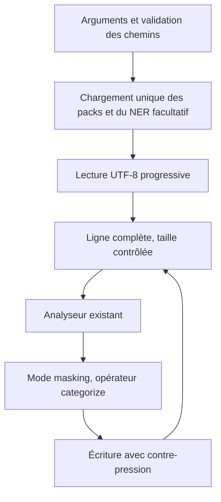

# Implémentation du CLI Lessive

**Statut :** implémentation V1 et recette locale terminées sur la branche `feat/cli` ; revue en PR à faire.

Ce document décrit le comportement de la première version du CLI. Le code est dans `src/cli` ; les commandes sont disponibles après `npm run build:cli` et installation locale. La revue en PR reste à faire.

Les futures sous-commandes `wash`, `tidy` et `clean` sont décrites séparément dans [evolution-cli.md](evolution-cli.md). Elles ne sont pas implémentées et ne changent pas le périmètre V1 ci-dessous.

## 1. Objectif et décisions retenues

Permettre de masquer les données personnelles détectées dans des fichiers texte locaux, notamment de gros logs, avant leur partage ou leur utilisation avec un assistant IA.

| Sujet | Décision pour la V1 |
|---|---|
| Transformation | Masquage par catégories : `[PERSONNE]`, `[EMAIL]`, `[IP]`… |
| Réversibilité | Aucune session, table de correspondance ou réidentification |
| Volume | Traitement progressif, ligne par ligne, avec mémoire bornée |
| Dates | Règles de dates désactivées par défaut ; option pour les activer |
| Reconnaissance des noms | NER facultatif, chargé explicitement depuis le disque |
| Entrée | Un fichier texte UTF-8 ou l'entrée standard |
| Sortie | Texte transformé sur stdout ou dans un nouveau fichier |
| Installation | Depuis le dépôt, compilation puis `npm link` ; aucune publication npm |

Le terme utilisé reste **masquage** : les données non détectées et le contexte peuvent encore permettre d'identifier une personne. Le CLI ne garantit pas l'anonymat.

Hors V1 : pseudonymisation, réidentification, mode document multiligne, traitement de répertoires ou de plusieurs fichiers, archives, PDF, documents bureautiques, suivi continu de fichiers, configuration de packs personnalisés et préservation de structures JSON/JSONL. Un fichier JSONL peut être traité comme du texte, mais sa validité JSON en sortie n'est pas garantie.

## 2. Interface de commande

```bash
lessive app.log -o app.masque.log
cat app.log | lessive > app.masque.log
lessive app.log --mask-dates
lessive app.log --ner ./models/Xenova/camembert-ner
lessive - --language en
```

### Arguments et options

| Argument ou option | Comportement |
|---|---|
| `[fichier]` | Un fichier à lire ; absence ou `-` : entrée standard |
| `-o, --output <fichier>` | Nouveau fichier de sortie ; absence : stdout |
| `--mask-dates` | Active les règles du pack `dates` |
| `--ner <dossier>` | Dossier du modèle local, contenant sa configuration, son tokenizer et ses poids q8 |
| `--language fr\|en\|all` | Langue des règles ; défaut `all`, sans filtrage linguistique |
| `--help` | Aide en français, exemples et limites principales |
| `--version` | Version du moteur fournie par `ENGINE_VERSION` |

Une option inconnue, une valeur invalide, une valeur manquante ou plusieurs fichiers d'entrée font échouer la commande avant lecture du texte. `--help` et `--version` ne chargent ni les packs ni le modèle.

### Sorties et codes de retour

- **stdout** : exclusivement le texte transformé, sans bannière, progression, statistiques ou saut de ligne supplémentaire.
- **stderr** : diagnostics en français. Sans NER, un avertissement unique signale que seules les règles sont utilisées et que des noms peuvent rester en clair. Ne pas répéter cet avertissement à chaque ligne.
- **Codes** : `0` succès ; `2` arguments invalides ; `1` erreur de lecture, écriture, encodage, analyse ou modèle ; `130` interruption par SIGINT.

Les diagnostics ne contiennent jamais de texte source, de valeur détectée, de pile d'appel ni de message brut d'une bibliothèque. Les numéros de ligne et des codes d'erreur contrôlés peuvent préciser la cause. Une rupture de sortie, notamment EPIPE, termine le traitement avec le code `1`.

## 3. Architecture et enchaînement

Créer un adaptateur Node dans `src/cli`. Il dépend de `src/core` et, uniquement si demandé, de `src/ner`. Le moteur reste indépendant de Node et de l'interface web : aucun changement des contrats publics de `src/core/types` n'est prévu.



### Initialisation

1. Valider les arguments et les conditions de sortie avant de lire le contenu.
2. Charger et valider les packs livrés avec `parsePack` et `PackRegistry`, depuis les fichiers distribués avec le CLI. Ne pas importer les utilitaires de test de `packs/_tools` dans le code de production.
3. Désactiver le pack `dates`, sauf si `--mask-dates` est présent. Conserver les règles actives par défaut des autres packs et le seuil moteur de `0,5`.
4. Construire un seul analyseur pour toute l'exécution. Pour `--language all`, ne pas renseigner le filtre linguistique de l'analyseur.
5. Si demandé, charger un seul moteur NER sur CPU, en q8. Utiliser l'interface existante `modelFiles` avec un adaptateur de lecture Node et un import dynamique de l'adaptateur NER.

Les lectures du modèle doivent rester dans le dossier sélectionné, y compris après résolution des liens symboliques. Ne faire aucune requête réseau, recherche automatique de modèle, écriture de cache ou tentative de téléchargement. Si le runtime CPU ou un fichier requis manque, retourner une erreur explicite, sans installation automatique.

### Analyse et transformation

Pour chaque ligne, appeler l'analyseur puis `transform` avec `{ mode: "masking", defaultOperator: "categorize" }`, sans session. Réutiliser les catégories existantes, sans inventer de nouveau format de repère.

L'analyseur actuel peut convertir un échec NER en avertissement et continuer avec les règles. L'adaptateur CLI doit détecter ce cas lorsqu'un modèle a été demandé et interrompre le traitement **avant d'émettre la ligne concernée**, sans dépendre de la comparaison d'un message traduit. Prévoir un adaptateur de `NerEngine` qui mémorise l'échec de reconnaissance pour cette vérification, sans modifier le contrat du moteur.

Ne conserver aucune liste cumulative de personnes, détections ou valeurs entre les lignes. Libérer le moteur NER dans le nettoyage de fin, y compris en cas d'erreur.

## 4. Lecture progressive et écriture

### Découpage

- Décoder l'UTF-8 progressivement en mode strict, en acceptant qu'un caractère soit réparti sur plusieurs blocs de lecture.
- Reconnaître les séparateurs LF et CRLF, en conservant exactement chaque séparateur et l'absence éventuelle de saut final. Le CR d'un CRLF peut être situé dans le bloc de lecture précédent.
- Traiter le contenu de chaque ligne indépendamment ; le séparateur est recopié après la transformation. Un CR isolé reste dans le contenu de la ligne.
- Accepter une entrée vide et les lignes vides. Conserver un éventuel BOM UTF-8 initial sans le présenter aux détecteurs.
- Refuser une ligne de plus de `MAX_INPUT_LENGTH`, soit actuellement **200 000 unités UTF-16**, séparateur et BOM exclus. Contrôler la limite pendant l'accumulation, sans attendre le séparateur de fin.
- Ne pas découper arbitrairement une ligne trop longue : une entité traversant la coupe pourrait rester partiellement en clair. Ne jamais recopier la ligne fautive comme solution de repli.

L'analyse ne dispose d'aucun contexte entre lignes : noms, adresses ou secrets multilignes ne bénéficient pas d'une détection transversale. Cette limite doit apparaître dans l'aide et les exemples de documentation.

### Mémoire et contre-pression

Analyser séquentiellement les lignes et attendre que la sortie puisse recevoir la suivante. Ne pas utiliser de file non bornée de lignes ni lancer toutes les analyses en parallèle. La mémoire des tampons dépend de la ligne courante et des blocs de lecture, pas de la taille totale du fichier. Le modèle et les packs sont chargés une fois et constituent un coût fixe supplémentaire.

### Fichier de sortie

Avec `--output`, refuser une destination déjà existante, y compris un lien symbolique. L'entrée n'est jamais modifiée.

Écrire uniquement le **résultat transformé** dans un fichier temporaire de permissions `0600`, créé exclusivement dans le dossier de destination. Après traitement et fermeture réussis, publier le résultat sans possibilité d'écraser une destination apparue entre-temps ; utiliser une opération atomique sans remplacement, par exemple la création d'un lien physique puis la suppression du nom temporaire. Si le système de fichiers ne le permet pas, échouer explicitement sans repli vers une écriture écrasante.

Supprimer le temporaire sur les erreurs et interruptions gérées. Ne pas créer de copie temporaire du texte original. Une interruption brutale du processus ou de la machine peut laisser le temporaire transformé ; ne pas promettre son nettoyage dans ce cas.

Avec stdout, les lignes déjà écrites ne peuvent pas être retirées après une erreur tardive. Documenter l'obligation de contrôler le code de sortie et recommander `--output` pour obtenir un fichier final uniquement après succès. Ne jamais montrer une redirection shell qui utilise le même fichier comme source et destination : le shell le tronquerait avant le démarrage du CLI.

## 5. Compilation et installation locale

Ajouter une compilation dédiée avec TypeScript déjà installé : émission JavaScript ES2022, modules ES et réécriture des extensions d'import TypeScript vers JavaScript. Le CLI compilé doit fonctionner avec les versions Node prises en charge par le projet, sans chargeur TypeScript expérimental.

- Ajouter `npm run build:cli` et un dossier généré distinct, `dist-cli/`, ignoré par Git, ESLint et Prettier.
- Compiler uniquement les modules nécessaires, sans l'interface Svelte, les workers web ni les tests.
- Copier les manifestes et règles des packs livrés en conservant leur arborescence relative ; les résoudre depuis le programme installé, jamais depuis le répertoire courant de l'utilisateur.
- Déclarer `lessive` dans `package.json`, avec un point d'entrée JavaScript portant le shebang Node.
- Inclure les sources CLI dans les contrôles TypeScript et ESLint appropriés à Node.
- Garantir que la compilation précède les tests en sous-processus du binaire, notamment via un script `pretest`.

Parcours d'installation à documenter une fois implémenté :

```bash
ONNXRUNTIME_NODE_INSTALL=skip npm ci
npm run build:cli
npm link
lessive --help
```

Aucune nouvelle dépendance à l'exécution ni publication npm. Si une dépendance supplémentaire devient nécessaire, arrêter ce changement de périmètre et demander l'accord du mainteneur conformément à R9.

## 6. Étapes de développement

Chaque étape doit livrer ses tests avec des données synthétiques uniquement.

- [x] **Socle exécutable** : compilation, binaire, analyse des arguments, aide et version ; exécution depuis un autre répertoire.
- [x] **Packs et transformation** : chargement des données distribuées, catégories, langues et activation optionnelle des dates.
- [x] **Flux borné** : décodage strict, séparateurs, limite par ligne, traitement séquentiel et contre-pression.
- [x] **Fichiers et erreurs** : sortie temporaire, publication sans écrasement, diagnostics contrôlés, codes de sortie et interruptions.
- [x] **NER local** : lecture confinée au dossier du modèle, chargement unique, interruption sur échec demandé, libération et absence de réseau.
- [x] **Documentation et recette** : README, architecture, limites, confidentialité, todo et entrée « Non publié » du changelog.

## 7. Tests et critères d'acceptation

### Tests fonctionnels et de flux

- Catégories attendues pour les données synthétiques couvertes par les packs : e-mails, IP, téléphones et identifiants validés. Construire les secrets de test selon les conventions du dépôt, sans chaîne ressemblant à un secret en clair dans les fichiers versionnés.
- Dates conservées par défaut et remplacées avec `--mask-dates` ; filtrage `fr`, `en` et absence de filtrage pour `all`.
- Entrée vide, lignes vides, LF, CRLF réparti entre deux blocs, BOM, absence de séparateur final, accents décomposés et emojis répartis entre plusieurs blocs.
- Ligne exactement à la limite acceptée ; dépassement rejeté avant émission de cette ligne ; UTF-8 invalide rejeté.
- Consommateur lent : vérifier que la lecture n'accumule pas tout le fichier pendant que la sortie est bloquée.

### Tests en sous-processus

- Exécuter le binaire compilé avec fichier et stdin ; vérifier les octets de sortie, stderr et les codes de retour.
- Vérifier arguments invalides, entrée absente ou illisible, destination existante, destination identique à l'entrée, lien symbolique et collision de destination au moment de publier.
- Provoquer une erreur tardive : aucune destination finale publiée avec `--output`, temporaire nettoyé ; sur stdout, préfixe déjà émis conservé et code d'échec.
- Vérifier interruption SIGINT, rupture de sortie, absence d'extraits sensibles dans les diagnostics et absence de copies du texte original sur disque.

### NER et confidentialité

- Tester avec un faux moteur les succès, échecs de chargement et échecs de reconnaissance après plusieurs lignes. Vérifier que le mode dégradé de l'analyseur ne conduit pas à une sortie silencieusement moins complète.
- Ajouter un test avec un vrai modèle local lorsqu'il est disponible ; son absence doit produire un test explicitement sauté, sans téléchargement.
- Vérifier l'absence de réseau et de cache persistant, avec et sans NER. Tester le confinement des chemins du modèle et les tentatives de sortie du dossier.
- Aucun changement du post-traitement NER n'est prévu. Toute modification ultérieure de ce moteur exige une nouvelle évaluation reportée dans `evaluation-ner.md`.

### Recette finale

Les contrôles requis sont `npm run lint`, `npm run typecheck`, `npm test`, `npm run build:cli`, `npm run build` et `npm run test:e2e`. Signaler les échecs et les tests sautés ; ne modifier ni les workflows ni les règles de protection pour les contourner.

Mesurer le débit et la mémoire sur un log synthétique d'au moins **100 Mo** avec des lignes courtes, puis comparer à une entrée de taille inférieure. Vérifier que le tampon applicatif et la quantité de travail en attente restent bornés ; reporter séparément la mémoire fixe du NER lorsqu'il est activé. Ne pas fixer de seuil de débit arbitraire avant cette première mesure.

L'implémentation sera proposée dans une PR, sans fusion ni publication automatique pendant le développement. Le compte rendu précisera ce qui est livré, les limites connues, les mesures et les vérifications effectivement exécutées.

## État de la recette sur `feat/cli`

Implémentation et documentation V1 présentes. Recette relancée le 20 novembre 2026 : lint et typecheck sans erreur, 1 788 tests unitaires réussis (3 tests sautés), compilation CLI et web réussies, 15 tests Chrome réussis sans saut. Le lancement Chrome dans le bac à sable est resté bloqué et a été interrompu ; la relance avec les permissions nécessaires a réussi. Le test CLI avec CamemBERT local sur CPU q8 a également réussi, sans téléchargement.

La revue locale a corrigé l'ouverture bloquante des tubes nommés : un chemin d'entrée ou de modèle désignant un tube sans producteur est maintenant refusé sans attendre. L'ouverture non bloquante précède la vérification du descripteur comme fichier ordinaire ; les erreurs de vérification ferment ce descripteur. Deux tests de régression en sous-processus couvrent ces cas sur les systèmes disposant de tubes nommés (sautés sous Windows). Pour l'entrée, le test vérifie aussi l'absence de destination finale et le nettoyage du temporaire.

La mesure sur logs synthétiques de 10 et 100 Mo est consignée dans [performances-cli.md](performances-cli.md). La mesure avec NER CPU q8 est également consignée : initialisation seule, 1 et 10 Mo (10 Mo en 693,19 s, pic RSS 1 179 376 Kio). Le passage de 100 Mo avec NER n’a pas été exécuté. L’essai WebGPU réalisé le 20 novembre réussit avec le modèle local q8, mais les trois séries courtes donnent une médiane de 145,97 ms/ligne contre 56,85 sur CPU ; le CLI reste sur CPU. Voir les conditions et limites dans le rapport de performances. La revue en PR reste à faire avant toute fusion ou publication.
